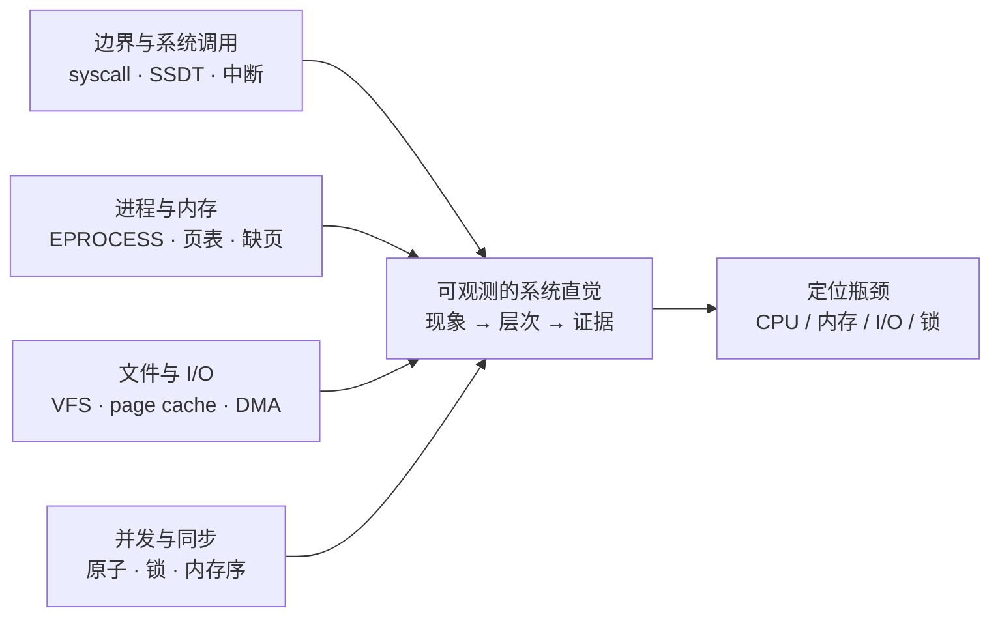

# 学习路线：12 周

> 一句话：12 周后，你能指着一个变慢的 Windows 程序说清「时间花在用户态、内核态还是硬件上」，并用手边的工具证明它。

## 是什么 / 为什么重要

这是一份「从会调 API 到能解释系统行为」的施工图，不是课程表：

| 它是什么 | 它不是什么 |
|:---:|---|
| 12 周、6 个阶段、每阶段 2 周的线性路线 | 一份「操作系统全部知识点」的清单 |
| 每个阶段都有可编译的实验或可复现的计数器 | 一堆书单和视频链接 |
| 用「读完必须能答」检验，而不是用「读完几章」检验 | 以页数/时长为进度的打卡表 |

为什么需要路线：操作系统的知识是**网状**的（缺页牵扯到页表、文件、调度、锁），按书目录线性读，读到一半就会同时挂着十几个没验证的概念。这条路线的做法是：**每 2 周只打通一层，每层都用本机数字收尾**，让「懂了」有可验证的形态。

## 能力模型

操作系统的地基是四块，缺一块都会卡住：

| 模块 | 必须掌握 | 为什么分析需要 |
|:---:|---|---|
| **边界与系统调用** | 用户态/内核态切换、syscall 表、参数与返回值传递 | 性能与故障分析的起点 |
| **进程与内存** | PCB/EPROCESS、上下文切换、四级页表、缺页异常 | 解释卡顿、崩溃与内存增长 |
| **文件与 I/O** | VFS/inode/page cache、中断与 DMA、I/O 模型 | 解释读写放大与阻塞 |
| **并发与同步** | 原子操作、锁、内存序、死锁四条件 | 解释竞态与性能抖动 |



推荐顺序：**边界 → 进程与内存 → 文件与 I/O → 并发 → 观测**。观测放最后不是因为它不重要，而是因为**你得先知道该看什么**，工具才有意义。

## 分周计划

12 周 = 6 个阶段，每阶段 2 周：

| 阶段 | 周次 | 主题 | 产出 |
|:---:|:---:|---|---|
| 1 | 1–2 | 内核边界与系统调用（含中断/异常） | [`labs/01-syscall-cost`](../labs/01-syscall-cost/) |
| 2 | 3–4 | 进程与线程 + 调度 | 进程/线程开销实测 |
| 3 | 5–6 | 虚拟内存与物理内存 | 缺页与内存增长分析 |
| 4 | 7–8 | 文件系统 + I/O 与设备 | 一次读路径的分层计时 |
| 5 | 9–10 | 同步与并发 + IPC | 锁竞争与竞态实验 |
| 6 | 11–12 | 内核观测与综合实验 | 一份完整的瓶颈定位报告 |

### 第 1–2 周：内核边界与系统调用（含中断/异常）

- 用户态 / 内核态、特权级、`syscall` 指令
- SSDT 与 ntdll stub：一次 `CreateFile` 到底走了多少层
- 中断、异常、IRQL 的区别（三个概念经常被混为一谈）
- 用 QPC 实测：syscall 往返、文件 I/O、线程创建、缺页

**产出**：[`labs/01-syscall-cost`](../labs/01-syscall-cost/) —— 一张全部来自本机实测的开销表。

**读完必须能答**：为什么一个「空」syscall 也要几十纳秒？为什么 `NtQuerySystemTime` 只要 2 ns？

### 第 3–4 周：进程与线程 + 调度

- PCB / EPROCESS / KTHREAD / TEB 各存什么
- `CreateProcess` 与 `fork + exec` 的路径差异
- 上下文切换到底保存了什么
- CFS 的 vruntime；Windows 的 32 级优先级与时间片

**产出**：用 `Get-Process` + 计数器解释一次「线程变多但 CPU 没满」的现象。

**读完必须能答**：上下文切换 2 µs 的代价由哪些部分组成？为什么线程不是「更轻的进程」这么简单？

### 第 5–6 周：虚拟内存与物理内存

- 四级页表、PTE 位、TLB
- 缺页异常的三条路径：软缺页 / 硬缺页 / 写时复制
- `VirtualAlloc` 的 reserve / commit / fault 三态
- buddy allocator、slab/pool、工作集与页回收

**产出**：解释「进程显示占用 500 MB，但物理内存只多了 50 MB」这类问题。

**读完必须能答**：commit 和 resident 差在哪？为什么首次触碰一页要 ~400 ns？

### 第 7–8 周：文件系统 + I/O 与设备

- VFS 四件套（superblock/inode/dentry/file）与 Windows 的 FILE_OBJECT
- NTFS 的 MFT、ext4 的 extent 对照
- page cache / Cache Manager 与读写放大
- 中断、DMA、IRP 栈；阻塞 / 非阻塞 / 多路复用 / 异步

**产出**：把一次文件读的时间拆到「cache 命中 / 缺页 / 磁盘」三层。

**读完必须能答**：`WriteFile` 返回成功，数据一定落盘了吗？

### 第 9–10 周：同步与并发 + IPC

- 原子指令、`lock` 前缀、内存序
- 自旋锁 / 互斥量 / 临界区 / SRWLock 的适用边界
- 死锁四条件与破坏方法
- 管道、共享内存、socket、命名对象；Windows 没有 POSIX signal

**产出**：一个能稳定演示「丢失更新」的程序，以及三种原语的竞争成本对比。

**读完必须能答**：`volatile` 为什么不是同步原语？

### 第 11–12 周：内核观测与综合实验

- ETW：provider / session / consumer
- `wpr.exe`、`typeperf.exe`、`Get-Counter` 的真实用法与限制
- Windows 上不装第三方工具能做到什么
- Linux 对照：`strace` / `perf` / eBPF（本机无法执行，只作概念对照）

**产出**：一份「现象 → 假设 → 计数器 → 结论」的完整报告。

**读完必须能答**：拿到四个数字（用户态时间、内核态时间、缺页次数、上下文切换次数），怎么判断它在等锁、等 I/O 还是换页？

## 动手验证

路线图不是用来读的，第一天就要跑起来。三件事，10 分钟内做完：

```powershell
# 1. 环境自检：确认本机有哪些工具、哪些没有
powershell -ExecutionPolicy Bypass -File .\tools\check-env.ps1

# 2. 跑第一个实验：系统调用与内核路径成本
cd labs\01-syscall-cost
powershell -ExecutionPolicy Bypass -File .\build.ps1

# 3. 采一条整机基线：每秒多少次系统调用
Get-Counter '\System\System Calls/sec' -MaxSamples 3
```

预期看到什么：

| 步骤 | 预期 |
|:---:|---|
| 1 | 8 行 `[ok]` / `[--]`，其中 `wsl` 为 `--`、`wpa/xperf` 为 `ok` |
| 2 | 五组表：memcpy 带宽、syscall 往返、文件 I/O、线程、缺页 |
| 3 | 读数在 10 万~300 万/秒之间跳动（机器越忙越高） |

如果第 2 步跑不出来，先看 [`labs/README.md`](../labs/README.md) 的环境要求，不要在工具链上耗三天。

## 机制与结构：为什么是这个顺序

三条理由，都来自踩过的坑：

1. **边界放最前**，因为后面每个概念都要用到它：缺页要进内核、文件读要进内核、加锁竞争要进内核。先量出「过一次边界 ≈ 70 ns」这个基准，后面才判断得出「这件事值不值得进内核」。
2. **内存放中间**，因为它是「性能解释力」最强的一层：卡顿、崩溃、内存增长、文件慢，追到底几乎都会碰到页表或 page cache。
3. **观测放最后**，因为工具只能放大你已经有的假设。没有「缺页多」这个假设，打开 ETW 只会看到几百万条事件。

## 三条学习原则

| 原则 | 落地方式 |
|:---:|---|
| **以题带练** | 每阶段先看「读完必须能答」，答不上再回去读；不从第一章开始通读 |
| **数字说话** | 任何结论都要带本机数字或计数器读数；没有数字的判断写成「待验证」 |
| **写下来** | 每条笔记必须含原始输出；模板见 [`notes/_TEMPLATE.md`](../notes/_TEMPLATE.md) |

> 12 周里最值钱的不是「读完了多少章」，而是**你手里有多少个自己能复现的数字**。

## 常见误区

1. **以为「会调 API 就等于懂内核」**。`malloc` 常常不触发系统调用（堆里还有空闲块），`read` 在 page cache 命中时一次磁盘都不碰。API 是接口，不是实现。
2. **以为背下 `EPROCESS` 的字段偏移就是懂内核**。偏移随 Windows build 变，服务号也变；该记的是「这个结构里有哪些类别的东西」，不是数字。
3. **以为工具能替代假设**。打开 ETW 录 30 秒，你会得到几百万条事件和更长的困惑；先有「我怀疑是硬缺页」，才知道该开哪个 provider、看哪个字段。
4. **以为 12 周能把书读完**。读不完。路线的目标是**建立可复用的排查动作**，不是覆盖所有章节；书是字典，不是小说。
5. **以为 Linux 那套可以直接套到 Windows**。`fork`、signal、`/proc`、`epoll` 在 Windows 上要么没有、要么名字和行为都不同；本仓库每处都会标出对照关系。

## 本机环境

这份日志的所有 Windows 实验都在同一台机器上完成。环境自检脚本在 [`tools/check-env.ps1`](../tools/check-env.ps1)：

```text
$ powershell -ExecutionPolicy Bypass -File .\tools\check-env.ps1
[ok] windows            windows 11 x64 (build 26200)
[ok] mingw-w64          gcc 14.2.0
[ok] python             3.11.0 (launcher: py)
[--] wsl                wsl.exe present, no usable distro (access denied)
[ok] etw                wpr.exe / typeperf.exe / Get-Counter
[--] procmon
[--] procexp
[--] windbg
[ok] wpa/xperf          installed (Windows Performance Toolkit)

page size          : 4096 bytes
logical processors : 20
available memory   : 1,328 MB
```

| 有 | 没有 / 不可用 |
|:---:|---|
| Windows 11 x64（build 26200）、MinGW-w64 gcc 14.2、Python 3.11（用 `py` 启动） | 可用的 WSL 发行版（`wsl.exe` 存在但 `wsl --list` 返回 `E_ACCESSDENIED`） |
| `wpr.exe`、`typeperf.exe`、`Get-Counter`、`logman.exe` | Procmon、Process Explorer、WinDbg |
| WPT（`wpa.exe` / `xperf.exe`，在 `E:\Windows Kits\10\Windows Performance Toolkit`） | `strace`、`perf`、eBPF、`/proc` |

三个必须说清的细节：

1. **`wsl.exe` 在，但没有可用发行版**。所以所有 Linux 命令都标注「本机不可执行」，只作概念对照；想跑 xv6 那类实验得另找 Linux 机器。
2. **WPA/xperf 装了，但 `.etl` 分析是 GUI 流程**，本仓库的命令行演示只用到「录得下来」为止，不要求你会用 WPA 界面。
3. **`python` 是 Microsoft Store 的占位程序**，直接敲会失败；装好的解释器用 `py`。

> 凡是没有标注「Linux 示例」的命令与数字，都是本机真实跑出来的；凡标注了的，都没有在本机执行过。


## 节奏建议

| 时段 | 做什么 | 说明 |
|:---:|---|---|
| 30 min | 读 | 只读当天要动手的那一节，不要通读 |
| 60 min | 做 | 跑 lab、改参数、记数字；**必须动手** |
| 15 min | 写 | 在 [`notes/`](../notes/) 留一条：现象、证据、结论 |

**每周只做一件事**：把本周的「读完必须能答」用嘴讲一遍。讲不顺的地方，就是下周要补的地方。

## 检验标准（自测 3 题）

学完不等于会了。用这三个问题自检，答不上来就是没到：

| # | 问题 | 对应能力 |
|:---:|---|---|
| 1 | 给你一次「读文件很慢」，你能沿着 page cache → 文件系统 → 块层 → 设备，指出时间花在哪一层吗？ | 文件与 I/O |
| 2 | 给你一个进程的四个数字（用户态时间、内核态时间、缺页次数、上下文切换次数），你能判断它在等锁、等 I/O、还是在换页吗？ | 进程与内存 |
| 3 | 给你一次偶发卡顿，你能用观测工具证明瓶颈是 CPU、内存还是锁竞争吗？ | 观测与综合 |

> 检验方式：合上电脑，用嘴讲。讲得出「为什么会这样」才算懂，只报得出工具名不算。

## 相关

- 第一站：[`01 · 内核边界`](./01-kernel-boundary.md)
- 第一个实验：[`labs/01-syscall-cost`](../labs/01-syscall-cost/)
- 记录模板：[`notes/_TEMPLATE.md`](../notes/_TEMPLATE.md)
- 任务清单：[`TASKS.md`](../TASKS.md)
